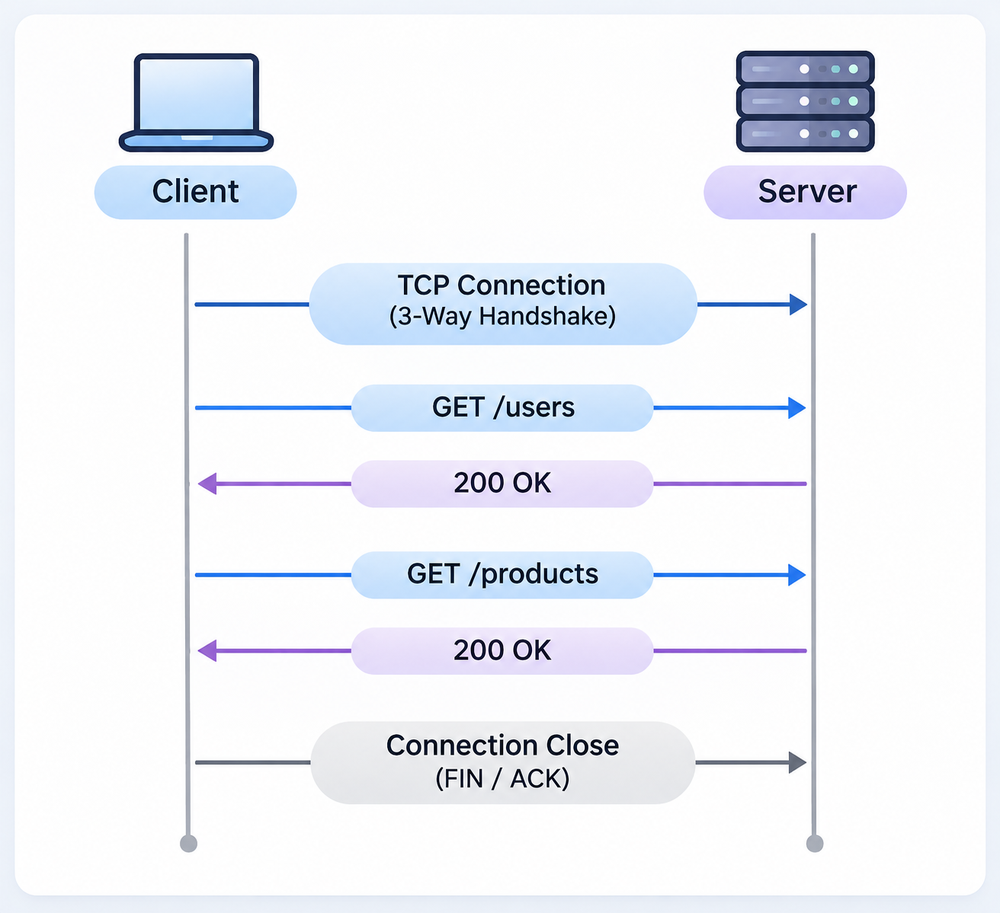
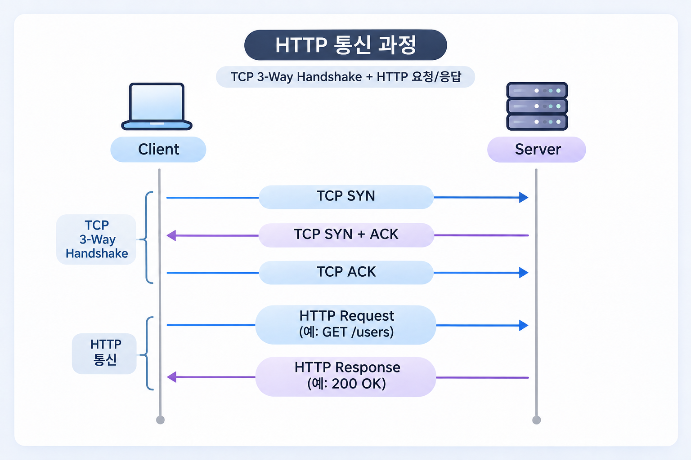
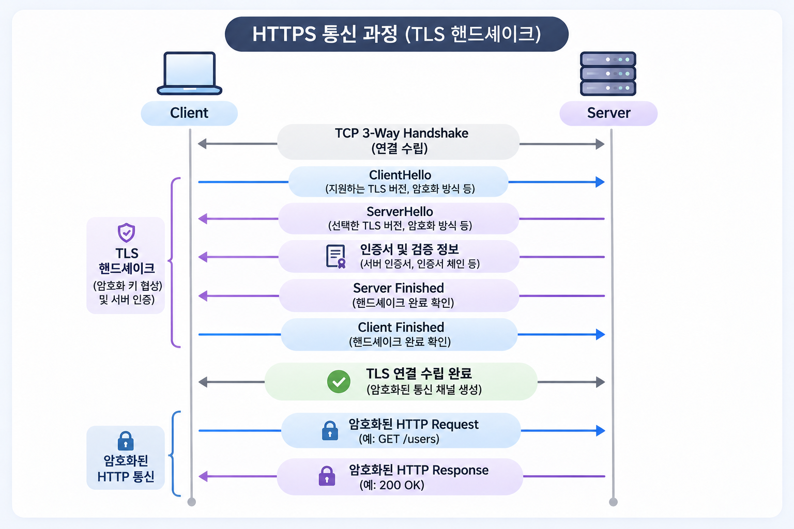
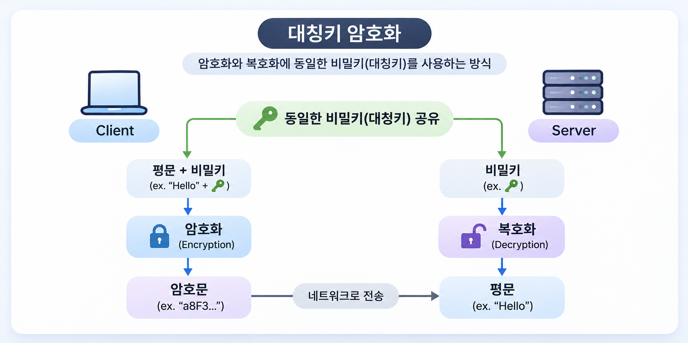

웹 브라우저에서 서버로 API 요청을 보내거나 웹 페이지에 접근할 때 HTTP 또는 HTTPS 프로토콜을 사용한다.

두 프로토콜 모두 클라이언트와 서버 사이에서 데이터를 주고받기 위해 사용되지만, 통신 과정에서 데이터를 보호하는 방식에 중요한 차이가 있다.

일반적으로 HTTPS는 HTTP에 보안 기능을 추가한 프로토콜이라고 설명한다. 하지만 실제로는 TLS(Transport Layer Security)를 통해 통신 상대를 인증하고, 암호화에 필요한 키를 협상하며, 데이터의 기밀성과 무결성을 보호한다.

이번 글에서는 HTTP와 HTTPS의 특징을 각각 살펴보고, 실제 통신 과정에서 어떤 차이가 발생하는지 알아본다.

## 1. HTTP란?
HTTP(Hypertext Transfer Protocol)는 클라이언트와 서버 사이에서 데이터를 주고받기 위한 애플리케이션 계층 프로토콜이다.

초기에는 HTML 문서를 전송하기 위해 설계되었지만, 현재는 JSON, 이미지, 동영상 등 다양한 데이터를 전달하는 데 사용된다.

### HTTP의 주요 특징
### 1. 요청과 응답 기반의 통신

HTTP는 클라이언트가 서버에 요청(Request)을 보내면 서버가 이에 대한 응답(Response)을 반환하는 구조다.

예를 들어 클라이언트가 사용자 정보를 요청하면 다음과 같은 통신이 발생한다.
```plain
GET /api/users/1 HTTP/1.1
Host: example.com
Accept: application/json
```

서버는 요청을 처리한 뒤 응답을 반환한다.
```plain
HTTP/1.1 200 OK
Content-Type: application/json

{
  "id": 1,
  "name": "Kim"
}
```

HTTP는 요청 메서드(GET, POST, PUT, PATCH, DELETE 등), 상태 코드(200, 404, 500 등), 헤더 등을 정의하여 클라이언트와 서버가 일관된 방식으로 통신할 수 있도록 한다.

### 2. Stateless(무상태성)

HTTP는 기본적으로 무상태 프로토콜이다.

서버는 각 HTTP 요청을 독립적으로 처리하며, 프로토콜 자체가 이전 요청의 사용자 상태를 자동으로 기억하지 않는다.

예를 들어 사용자가 로그인한 이후 다른 API를 호출하더라도 HTTP 자체만으로는 해당 사용자가 로그인했는지 알 수 없다.

따라서 애플리케이션에서는 쿠키, 세션, JWT 등을 이용하여 사용자 인증 상태를 관리한다.

여기서 Stateless는 TCP 연결을 매번 종료한다는 의미가 아니다. HTTP의 무상태성과 TCP 연결의 재사용은 서로 다른 개념이다.

### 3. Connection 재사용

HTTP/1.0에서는 일반적으로 요청마다 새로운 TCP 연결을 생성했지만, HTTP/1.1부터는 지속 연결(Persistent Connection)이 기본 동작이 되었다.

이를 통해 여러 HTTP 요청이 동일한 TCP 연결을 재사용할 수 있다.


연결을 재사용하면 매 요청마다 TCP 핸드셰이크를 수행할 필요가 없어 네트워크 오버헤드를 줄일 수 있다.

다만 HTTP/1.1에서는 하나의 연결에서 요청과 응답을 처리하는 방식에 제약이 있어 HTTP/2의 멀티플렉싱이 등장하게 되었다.

### 4. 암호화되지 않은 평문 통신

일반적인 HTTP 통신은 데이터를 암호화하지 않고 전송한다.

따라서 네트워크 경로에서 패킷을 관찰할 수 있는 공격자는 HTTP 요청과 응답의 내용을 확인하거나 변조할 수 있다. ([Man in the middle attack](https://en.wikipedia.org/wiki/Man-in-the-middle_attack))

예를 들어 다음과 같은 로그인 요청이 있다고 가정하자.
```plain
POST /login HTTP/1.1
Host: example.com
Content-Type: application/json

{
  "username": "admin",
  "password": "123456"
}
```

HTTP를 사용한다면 요청 본문에 포함된 사용자 계정과 비밀번호가 네트워크에서 평문으로 전달된다.

이는 HTTP가 가진 대표적인 보안 문제다.

## 2. HTTPS란?
HTTPS(Hypertext Transfer Protocol Secure)는 HTTP 통신을 TLS로 보호하는 방식이다.

HTTP의 요청·응답 구조, 메서드, 상태 코드 등은 그대로 사용하면서 TLS를 통해 데이터 전송 구간의 보안을 제공한다.

HTTPS가 제공하는 핵심 보안 기능은 세 가지다.

### 1. 기밀성(Confidentiality)
클라이언트와 서버가 주고받는 데이터를 암호화하여 제3자가 내용을 확인하기 어렵게 한다.

예를 들어 로그인 요청에 비밀번호가 포함되어 있더라도 TLS로 암호화된 네트워크 패킷만 관찰해서는 원래 데이터를 쉽게 알아낼 수 없다.

### 2. 무결성(Integrity)
통신 과정에서 데이터가 변경되었는지 검증한다.

공격자가 암호화된 데이터를 임의로 수정하더라도 TLS의 인증 암호화 메커니즘을 통해 변조를 탐지할 수 있다.

### 3. 인증(Authentication)
클라이언트는 서버가 제시한 TLS 인증서를 검증하여 접속하려는 서버의 신원을 확인한다.

일반적인 HTTPS에서는 서버 인증이 기본이며, 필요에 따라 클라이언트 인증서를 사용하는 mTLS(Mutual TLS)를 구성할 수도 있다.

단, 유효한 인증서가 있다고 해서 해당 웹사이트의 운영자가 반드시 신뢰할 만하다는 뜻은 아니다. 인증서는 주로 접속한 도메인과 서버의 인증 관계를 검증하는 역할을 한다.

## 3. HTTP와 HTTPS의 차이
|구분	|HTTP|	HTTPS|
|----|----|----|
|기본 목적|	데이터 요청 및 응답	|TLS로 보호되는 HTTP 통신
|기본 포트|	80|	443|
|암호화	|기본적으로 없음 |	TLS 암호화|
|데이터 무결성|	네트워크 공격에 대한 암호학적 보호 없음 |	TLS로 변조 탐지|
|서버 인증|	기본 제공하지 않음|	인증서 기반 서버 인증|
|전송 프로토콜	|HTTP/1.1·2는 주로 TCP, HTTP/3는 QUIC|	HTTP/1.1·2는 TLS over TCP, HTTP/3는 QUIC 내 TLS 1.3|
|연결 과정	|TCP 연결 등	|전송 연결 및 TLS 핸드셰이크|
|주요 사용처|	내부 테스트, 제한된 환경|	웹사이트, API, 인증 및 결제 서비스|

핵심 차이는 HTTP 메시지를 전송할 때 TLS를 통해 통신을 보호하는지 여부다.

HTTP와 HTTPS는 서로 완전히 다른 애플리케이션 프로토콜이 아니다. HTTPS에서도 동일한 HTTP 메서드와 상태 코드를 사용한다.

## 4. HTTP와 HTTPS의 통신 과정
HTTP와 HTTPS의 차이를 더 명확하게 이해하기 위해 각각의 연결 과정을 비교해 보자.

#### HTTP 통신 과정
HTTP/1.1을 TCP 위에서 사용하는 경우 다음과 같은 순서로 통신이 이루어진다.


TCP 3-way handshake를 통해 연결이 수립되면 HTTP 요청을 전송할 수 있다.

TCP는 데이터의 신뢰성 있는 전달과 순서 보장을 담당하지만, 전송되는 데이터 자체를 암호화하지는 않는다.

#### HTTPS 통신 과정
HTTPS에서는 TCP 연결 이후 TLS 핸드셰이크가 추가된다.

다음은 TLS 1.3을 사용하는 일반적인 HTTPS 연결의 개념적인 흐름이다.


TLS 핸드셰이크 과정에서 클라이언트와 서버는 암호화에 사용할 키를 협상하고 서버 인증서를 검증한다.

TLS 1.3에서는 일반적인 전체 핸드셰이크에 1 RTT가 필요하다. TLS 1.2에서는 일반적인 전체 핸드셰이크에 2 RTT가 필요했기 때문에 연결 수립 지연이 개선되었다.

여기서 RTT(Round Trip Time)는 클라이언트에서 서버로 데이터를 보내고 그에 대한 응답이 돌아오는 데 걸리는 시간을 의미한다.

## 5. HTTPS는 어떻게 데이터를 암호화할까?
HTTPS의 핵심은 TLS이며, TLS에서는 비대칭키 암호화와 대칭키 암호화의 원리를 함께 활용한다.

#### 대칭키 암호화
대칭키 암호화는 암호화와 복호화에 동일한 비밀키를 사용하는 방식이다.

대표적인 알고리즘으로 AES가 있다.


대칭키 암호화는 일반적으로 비대칭키 연산보다 빠르기 때문에 실제 HTTP 데이터를 암호화하는 데 사용된다.

다만 통신 당사자가 안전하게 비밀키를 공유해야 한다는 문제가 있다.

#### 비대칭키 암호화
비대칭키 암호화는 공개키(Public Key)와 개인키(Private Key)를 사용하는 방식이다.

공개키는 외부에 공개할 수 있지만, 개인키는 소유자만 안전하게 보관해야 한다.

비대칭키 암호 기술은 암호화뿐 아니라 디지털 서명과 키 교환 과정에도 활용된다.

다만 TLS 1.3에서는 서버의 공개키로 대칭키를 암호화해 전달하는 방식이 아니라, 주로 (EC)DHE 키 교환을 통해 공유 비밀을 생성한다.

TLS 1.3의 키 교환 과정을 간단히 살펴보자.
1. 클라이언트와 서버가 각각 임시 키 쌍을 생성한다.
2. 서로의 공개 키 교환 정보를 전달한다.
3. 각자의 개인키와 상대방의 공개 키 정보를 이용하여 공유 비밀을 계산한다.
4. HKDF 기반 키 파생 과정을 통해 실제 통신에 사용할 대칭키를 생성한다.
5. 이후 HTTP 데이터를 대칭키 기반 인증 암호화 방식으로 보호한다.
이 과정에서는 서버의 인증서와 디지털 서명을 이용해 키 교환 상대를 인증한다.

또한 임시 키 교환을 사용하기 때문에 서버의 장기 개인키가 나중에 유출되더라도 과거에 수집된 통신 내용을 쉽게 복호화할 수 없도록 하는 **전방향 비밀성(Forward Secrecy)**을 제공한다.

## 6. SSL/TLS 인증서는 어떤 역할을 할까?
HTTPS에서는 서버의 신원을 검증하기 위해 TLS 인증서를 사용한다.

인증서에는 일반적으로 다음과 같은 정보가 포함된다.
- 인증서가 유효한 도메인
- 서버의 공개키
- 인증서 발급자(Issuer)
- 인증서 유효 기간
- 인증 기관의 디지털 서명

브라우저는 서버가 전달한 인증서를 검증할 때 인증서의 신뢰 체인, 도메인 일치 여부, 유효 기간 등을 확인한다. 인증서 폐기 상태도 클라이언트 정책과 지원 기능에 따라 확인할 수 있다.

인증 기관(CA, Certificate Authority)은 이러한 인증서를 발급하고 서명하는 역할을 한다.

여기서 인증서는 암호화에 사용할 비밀키 자체를 전달하는 것이 아니라, 공개키와 서버의 신원을 연결하고 이를 검증할 수 있도록 하는 수단이라는 점이 중요하다.

## 7. HTTPS는 HTTP보다 느릴까?
HTTPS는 TLS 핸드셰이크와 암호화·복호화 연산이 필요하므로 HTTP보다 추가적인 비용이 발생할 수 있다.

하지만 HTTPS가 반드시 체감상 더 느리다고 볼 수는 없다.

그 이유는 다음과 같다.

### 첫째, 연결을 재사용할 수 있다.

HTTP Keep-Alive와 커넥션 풀을 사용하면 매 요청마다 TCP 및 TLS 핸드셰이크를 수행하지 않아도 된다.

### 둘째, TLS 1.3에서는 핸드셰이크 비용이 개선되었다.

일반적인 전체 핸드셰이크가 1 RTT로 완료되며, 조건이 충족되면 세션 재개와 0-RTT 데이터 전송도 가능하다.

다만 0-RTT 데이터는 재전송 공격(Replay Attack)에 대한 고려가 필요하다.

### 셋째, HTTP/2와 HTTP/3를 활용할 수 있다.

HTTP/2는 하나의 연결에서 여러 요청과 응답을 동시에 처리하는 멀티플렉싱을 지원한다.

HTTP/3는 QUIC을 기반으로 동작하며 TCP 수준의 HOL(Head-of-Line) Blocking 문제를 완화한다.

따라서 실제 서비스 성능은 TLS 암호화 비용뿐 아니라 연결 재사용, 네트워크 지연, HTTP 버전, 서버 구성 등에 따라 달라진다.

## 8. HTTP/1.1, HTTP/2, HTTP/3와 HTTPS의 관계
HTTP 버전과 HTTPS는 서로 다른 기준의 개념이다.

HTTP 버전은 메시지 전송 방식과 연결 처리 구조를 정의하며, HTTPS는 HTTP 통신을 안전하게 보호하는 방식이다.

|구분|	HTTP/1.1|	HTTP/2|	HTTP/3|
|----|----|----|----|
|주요 전송 기반|	TCP|	TCP|	QUIC(UDP 기반)|
|메시지 형식|	텍스트 기반|	바이너리 프레임	| 바이너리 프레임|
|멀티플렉싱	|지원하지 않음	|지원|	지원|
|TLS 사용	|선택 가능	|일반적인 브라우저 환경에서 사용	|QUIC에 TLS 1.3 통합|
|주요 특징|	지속 연결	|헤더 압축, 멀티플렉싱	|연결 수립 개선, 스트림별 손실 처리|

HTTP/2 자체가 TLS를 필수로 요구하는 것은 아니지만, 일반적인 웹 브라우저에서는 HTTPS를 통해 HTTP/2를 사용한다.

HTTP/3는 QUIC을 사용하며 TLS 1.3을 통합하고 있기 때문에 기존 HTTP/1.1, HTTP/2와 연결 구조가 다르다.

## 9. HTTPS를 사용하면 모든 데이터가 안전할까?
HTTPS를 사용한다고 해서 모든 보안 문제가 해결되는 것은 아니다.

TLS는 주로 통신 구간을 보호한다.

예를 들어 HTTPS로 전달된 데이터도 서버에서 복호화한 이후에는 애플리케이션의 처리 방식에 따라 노출될 수 있다.

또한 다음과 같은 문제는 HTTPS만으로 해결할 수 없다.
- SQL Injection, XSS와 같은 애플리케이션 취약점
- 서버 내부에서 발생하는 민감 정보 유출
- 잘못된 인증 및 인가 처리
- 로그에 비밀번호나 토큰을 기록하는 문제
그리고 HTTPS를 사용하더라도 IP 주소나 일부 연결 메타데이터는 네트워크에서 관찰할 수 있다. DNS 조회 방식이나 ECH(Encrypted ClientHello) 지원 여부에 따라 접속하려는 도메인 정보가 노출될 수도 있다.

따라서 HTTPS는 서비스 보안의 기본 요소이지만, 서비스 전체의 보안을 보장하는 것은 아니다.

## 10. 마무리
HTTP와 HTTPS는 모두 클라이언트와 서버가 데이터를 주고받기 위한 HTTP 프로토콜을 사용한다.

차이는 통신 구간에서 데이터를 어떻게 보호하는지에 있다.

HTTP는 별도의 보안 계층이 없다면 데이터를 평문으로 전달하지만, HTTPS는 TLS를 이용해 데이터의 기밀성과 무결성을 보호하고 통신 상대를 인증한다.

특히 HTTPS를 이해할 때는 다음 세 가지를 구분하는 것이 중요하다.
1. HTTP는 요청과 응답의 의미와 형식을 정의한다.
2. TLS는 통신 상대의 인증과 데이터 암호화를 담당한다.
3. TCP 또는 QUIC은 데이터를 전송하기 위한 기반을 제공한다.

실제 백엔드 서비스에서는 로드 밸런서나 리버스 프록시에서 TLS를 종료하고 내부 애플리케이션 서버로 HTTP 요청을 전달하는 구성도 흔히 사용한다.

따라서 HTTPS를 이해하는 것은 단순한 웹 보안 지식을 넘어, 실제 서버의 네트워크 아키텍처를 설계하고 운영하는 데에도 도움이 된다.

---

## 참고 자료
- [RFC 9110 — HTTP Semantics](https://www.rfc-editor.org/rfc/rfc9110.html)
- [RFC 8446 — TLS 1.3](https://www.rfc-editor.org/rfc/rfc8446.html)
- [RFC 9113 — HTTP/2](https://www.rfc-editor.org/rfc/rfc9113.html)
- [RFC 9114 — HTTP/3](https://www.rfc-editor.org/rfc/rfc9114.html)
