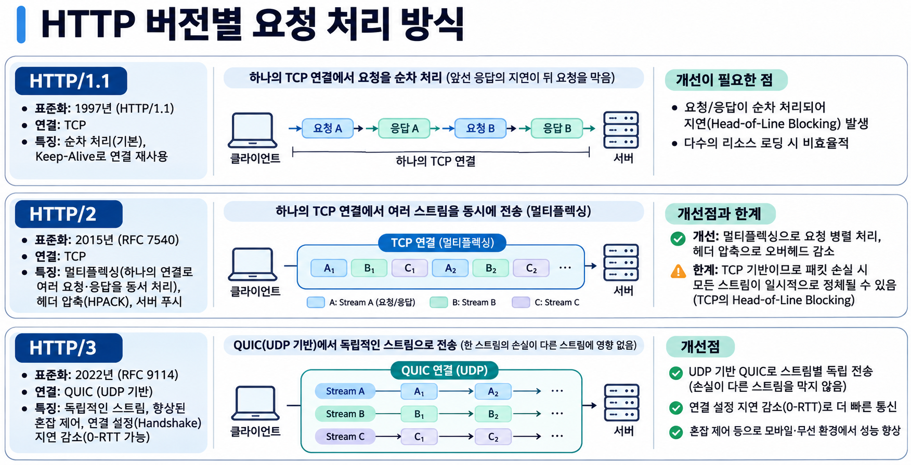

# HTTP/1.0부터 HTTP/3까지: HTTP는 어떻게 발전해 왔을까?

> HTTP 버전별 특징과 개선 사항을 살펴보고, 각 버전이 해결하려 했던 네트워크 병목을 이해한다.



## 1. HTTP란?

HTTP(Hypertext Transfer Protocol)는 클라이언트와 서버가 요청(Request)과 응답(Response)을 교환하기 위한 애플리케이션 계층 프로토콜이다. 웹 브라우저뿐 아니라 REST API, 프록시, CDN 등 다양한 시스템에서 사용한다.

HTTP 버전이 바뀌어도 `GET`, `POST`, 상태 코드, 헤더 등 핵심 의미(semantics)는 대체로 유지된다. 주로 달라지는 것은 **메시지를 어떻게 표현하고, 연결을 어떻게 활용하며, 여러 요청을 얼마나 효율적으로 전송하는가**이다.

## 2. 한눈에 비교하기

| 항목 | HTTP/1.0 | HTTP/1.1 | HTTP/2 | HTTP/3 |
|---|---|---|---|---|
| 대표 표준화 연도 | 1996 | 1997 | 2015 | 2022 |
| 기반 전송 | 주로 TCP | 주로 TCP | TCP | QUIC(UDP 기반) |
| 메시지 표현 | 텍스트 | 텍스트 | 바이너리 프레임 | QUIC 스트림 위의 바이너리 프레임 |
| 연결 재사용 | 기본적으로 요청마다 새 연결 | 기본적으로 지속 연결 | 하나의 연결에서 다중 스트림 | 하나의 QUIC 연결에서 다중 스트림 |
| 동시 요청 처리 | 여러 TCP 연결 필요 | 여러 연결 또는 제한적인 파이프라이닝 | 멀티플렉싱 | 독립 QUIC 스트림 멀티플렉싱 |
| 헤더 압축 | 없음 | 없음 | HPACK | QPACK |
| 주요 개선 | 헤더·상태 코드 도입 | 연결 재사용·Host·청크 전송 | 멀티플렉싱·헤더 압축 | 전송 계층 HOL 완화·연결 설정 개선 |

> 표는 대표적인 웹 환경을 기준으로 단순화했다. 예를 들어 HTTP/1.0에도 Keep-Alive 확장이 존재했고, HTTP/2는 명세상 반드시 TLS를 요구하지는 않는다.

## 3. HTTP/0.9: 문서를 가져오는 단순한 프로토콜

초기 HTTP/0.9는 사실상 `GET` 요청으로 HTML 문서를 받아오는 매우 단순한 형태였다. 헤더와 상태 코드가 없었고 응답은 문서 본문 자체였다.

```http
GET /index.html
```

문서 이외의 다양한 리소스를 다루고, 오류 상태나 메타데이터를 표현하기에는 한계가 있었다.

## 4. HTTP/1.0: 메시지에 의미를 부여하다

HTTP/1.0은 요청·응답에 버전, 상태 코드, 헤더를 도입했다. `Content-Type`으로 HTML 외의 이미지나 파일 등 다양한 콘텐츠를 구분할 수 있게 되었다.

```http
GET /index.html HTTP/1.0
User-Agent: ExampleClient/1.0

HTTP/1.0 200 OK
Content-Type: text/html
Content-Length: 18

<html>Hello</html>
```

### 문제: 매번 연결하는 비용

기본 동작에서는 요청마다 TCP 연결을 생성하고 응답 후 종료했다. 웹 페이지가 HTML, CSS, JavaScript, 이미지 등 여러 리소스로 구성되면 연결 설정과 종료가 반복된다. TCP 3-way handshake에는 일반적으로 1 RTT가 필요하고, HTTPS라면 TLS 연결 설정 비용도 추가된다.

```text
Client                          Server
  | -------- TCP 연결 ---------> |
  | -------- GET /a ----------> |
  | <------- Response /a ------- |
  | -------- 연결 종료 --------- |
  |                              |
  | -------- TCP 연결 ---------> |
  | -------- GET /b ----------> |
  | <------- Response /b ------- |
  | -------- 연결 종료 --------- |
```

**다음 버전의 과제:** 연결을 매번 새로 만들지 않고 재사용할 수 없을까?

## 5. HTTP/1.1: 연결 재사용과 효율적인 전송

HTTP/1.1은 지속 연결(Persistent Connection)을 기본 동작으로 만들어 동일한 TCP 연결을 여러 요청에 재사용하도록 했다. 흔히 Keep-Alive라고 부른다.

```http
GET /users HTTP/1.1
Host: api.example.com
Accept: application/json
```

### 주요 개선 사항

**① Persistent Connection:** 연결 설정 비용을 여러 요청에 분산한다. `Connection: close`로 종료 의사를 나타낼 수 있다.

**② Host 헤더:** 같은 IP 주소를 공유하는 여러 가상 호스트 중 어느 호스트를 요청하는지 구분한다. HTTP/1.1 요청에서 `Host`는 필수다.

**③ Chunked Transfer Encoding:** 전체 응답 크기를 미리 알 수 없어도 본문을 청크 단위로 전송할 수 있다.

**④ 캐시와 콘텐츠 협상:** 캐시 제어 및 `Accept-*` 헤더를 통한 표현 선택이 정교해졌다.

**⑤ Pipelining:** 앞선 응답을 기다리지 않고 여러 요청을 연속으로 전송할 수 있다. 다만 응답 순서를 유지해야 하므로 HOL Blocking을 해결하지 못했고, 호환성 문제로 일반적인 브라우저에서 널리 사용되지 않았다.

### 문제: 애플리케이션 계층의 HOL Blocking

하나의 HTTP/1.1 연결에서는 보통 요청과 응답을 순차적으로 처리한다. 파이프라이닝을 사용해도 응답은 요청 순서대로 반환해야 한다. 앞선 응답이 지연되면 뒤의 응답도 기다려야 한다. 이것이 **Head-of-Line(HOL) Blocking**이다.

```text
요청:    A --------> B --------> C -------->
응답:    [ A: 오래 걸림 ][ B ][ C ]
                         ↑
                B와 C도 대기
```

브라우저는 이를 완화하기 위해 동일 출처에 여러 TCP 연결을 열었지만, 연결 수가 늘면 핸드셰이크, 메모리, 혼잡 제어 등의 부담도 증가한다.

**다음 버전의 과제:** 하나의 연결에서 여러 요청과 응답을 동시에 처리할 수 없을까?

## 6. HTTP/2: 멀티플렉싱과 바이너리 프레이밍

HTTP/2는 HTTP의 의미를 바꾸지 않고 메시지의 전송 방식을 개선했다. 핵심은 **바이너리 프레이밍(Binary Framing)**과 **멀티플렉싱(Multiplexing)**이다.

### 6.1 바이너리 프레임

HTTP/1.1의 텍스트 메시지와 달리 HTTP/2는 메시지를 HEADERS, DATA 등의 프레임으로 나눈다. 각 프레임은 특정 스트림에 속한다.

- **Connection:** 클라이언트와 서버 사이의 TCP 연결
- **Stream:** 하나의 HTTP 요청·응답 교환에 대응하는 논리적 흐름
- **Frame:** 스트림에서 교환하는 작은 프로토콜 단위

### 6.2 멀티플렉싱

하나의 TCP 연결에서 서로 다른 스트림의 프레임을 섞어 전송할 수 있다. 요청 A의 응답이 끝나기 전에 B와 C의 응답 프레임을 전송할 수 있으므로 HTTP/1.1의 응답 순서 제약을 없앤다.

```text
HTTP/1.1 (한 연결의 일반적인 동작)
TCP: [ A1 A2 A3 ][ B1 B2 ][ C1 C2 ]

HTTP/2
TCP: [ A1 B1 C1 A2 C2 B2 A3 ]
       └ 서로 다른 스트림의 프레임이 교차 ┘
```

### 6.3 HPACK 헤더 압축

요청마다 반복되는 `User-Agent`, `Cookie` 등의 헤더를 HPACK으로 압축해 전송 오버헤드를 줄인다. 특히 작은 API 응답을 자주 주고받을 때 헤더 비중이 크다면 효과적이다.

### 6.4 Server Push

서버가 클라이언트의 명시적 요청 전에 리소스를 선제적으로 전송할 수 있도록 설계되었다. 하지만 실제 활용도와 캐시 복잡성 등의 문제로 주요 브라우저에서 지원이 축소·제거되었다. **HTTP/2의 핵심 장점으로 과도하게 강조할 기능은 아니다.**

### 남은 문제: TCP 계층의 HOL Blocking

HTTP/2는 HTTP 메시지 수준의 HOL Blocking을 완화했지만, 여전히 **하나의 TCP 연결**을 사용한다. TCP는 바이트 스트림을 순서대로 애플리케이션에 전달한다. 중간 패킷이 손실되면 이후에 도착한 데이터도 손실된 바이트가 복구될 때까지 상위 계층에 전달되지 못할 수 있다. 이로 인해 **서로 다른 HTTP/2 스트림도 함께 지연**된다.

```text
TCP에서 패킷 손실 발생

[ A1 ][ B1 손실 ][ C1 ][ A2 ]
             ↓
     B1이 재전송될 때까지
     뒤의 바이트 전달 지연
```

**다음 버전의 과제:** 스트림 하나의 패킷 손실이 다른 스트림까지 멈추게 하는 문제를 줄일 수 없을까?

## 7. HTTP/3: TCP를 벗어나 QUIC으로

HTTP/3는 HTTP/2의 멀티플렉싱 개념을 유지하면서 전송 기반을 **TCP에서 QUIC으로 변경**했다. QUIC은 UDP 위에서 동작하지만, 단순히 UDP의 비신뢰성에 의존하는 프로토콜은 아니다. QUIC 자체가 신뢰성 있는 전송, 손실 복구, 혼잡 제어, 스트림 관리 및 암호화를 제공한다.

### 7.1 스트림별 독립적인 데이터 전달

QUIC은 스트림마다 순서 있는 바이트 전달을 보장한다. 특정 스트림의 데이터가 손실되어도 다른 스트림의 데이터는 계속 애플리케이션에 전달될 수 있다.

```text
QUIC Connection
 ├─ Stream A: [A1] [A2] [A3]  → 진행
 ├─ Stream B: [B1] [손실]      → B만 복구 대기
 └─ Stream C: [C1] [C2] [C3]  → 진행
```

이는 **TCP의 연결 전체에 걸친 HOL Blocking을 줄이는 것**이지, 네트워크 손실의 영향이 완전히 사라진다는 뜻은 아니다. QUIC 연결의 여러 스트림은 여전히 대역폭과 혼잡 제어 상태를 공유한다.

### 7.2 연결 설정 지연 개선

QUIC은 TLS 1.3 핸드셰이크를 전송 계층에 통합한다. 일반적인 새 QUIC 연결은 1-RTT 핸드셰이크로 애플리케이션 데이터 전송을 시작할 수 있다. 이전에 연결했던 서버에 재접속할 때는 조건이 맞으면 **0-RTT 조기 데이터**도 가능하다.

단, 0-RTT는 항상 가능한 것이 아니며 재전송(Replay) 공격 위험 때문에 서버와 애플리케이션이 허용하는 요청에 제한적으로 사용해야 한다.

### 7.3 Connection ID와 연결 이동

QUIC은 연결을 단순히 IP 주소와 포트 조합으로만 식별하지 않고 Connection ID를 활용한다. 따라서 Wi-Fi에서 모바일 데이터로 전환하는 등 네트워크 경로가 바뀌더라도 조건이 맞으면 기존 연결을 유지할 수 있다.

### 7.4 QPACK 헤더 압축

HTTP/3는 HTTP/2의 HPACK 대신 QPACK을 사용한다. QUIC 스트림의 독립적인 전송 특성을 고려해 헤더 압축 상태의 동기화로 발생할 수 있는 불필요한 차단을 줄이도록 설계됐다.

### HTTP/3의 제약

UDP 트래픽이 제한된 네트워크에서는 HTTP/3 연결이 실패할 수 있으며, 클라이언트는 HTTP/2 등 TCP 기반 버전으로 폴백할 수 있다. 또한 QUIC은 구현·운영·모니터링 관점에서 TCP와 다른 고려 사항이 필요하다. **HTTP/3가 모든 환경에서 HTTP/2보다 빠른 것은 아니다.**

## 8. HOL Blocking을 정확히 구분하기

| 구분 | HTTP/1.1 | HTTP/2 | HTTP/3 |
|---|---|---|---|
| HTTP 메시지 수준 HOL | 순차 응답·파이프라이닝에서 발생 | 멀티플렉싱으로 완화 | 멀티플렉싱으로 완화 |
| 전송 계층 HOL | TCP 순서 보장의 영향 | TCP 연결의 모든 스트림에 영향 가능 | QUIC 스트림별 손실 복구로 완화 |
| 손실 시 다른 요청 영향 | 같은 TCP 연결에 영향 | 같은 TCP 연결의 다른 스트림도 정체 가능 | 다른 스트림은 데이터 전달을 계속할 수 있으나 공유 혼잡 제어의 영향은 남음 |

여기서 가장 중요한 구분은 **HTTP/2가 HOL Blocking을 완전히 없앤 것은 아니라는 점**이다. HTTP/2는 HTTP 계층의 병목을 줄였고, HTTP/3는 TCP의 연결 단위 순서 보장으로 생기는 병목을 완화했다.

## 9. 실무에서 확인해 보기

### curl로 HTTP 버전 확인

```bash
# 서버가 협상한 HTTP 버전 출력
curl -sS -o /dev/null -w '%{http_version}\n' https://example.com

# HTTP/1.1 요청
curl --http1.1 -I https://example.com

# HTTP/2 요청 (curl 빌드에서 지원해야 함)
curl --http2 -I https://example.com

# HTTP/3 요청 (HTTP/3 지원 curl 빌드 필요)
curl --http3 -I https://example.com
```

`--http3`는 서버와 네트워크 상황에 따라 다른 버전으로 폴백할 수 있다. HTTP/3만 강제하려면 `--http3-only`를 사용한다.

### 브라우저에서 확인

Chrome 개발자 도구의 Network 탭에서 Protocol 열을 활성화하면 요청별 `http/1.1`, `h2`, `h3` 등을 확인할 수 있다.

### 백엔드 개발 시 유의할 점

실제 운영 환경에서는 **브라우저 → CDN/로드 밸런서 → 애플리케이션 서버** 구간마다 서로 다른 HTTP 버전을 사용할 수 있다. 브라우저와 CDN 사이가 HTTP/3라고 해서 CDN과 백엔드 사이도 HTTP/3인 것은 아니다.

HTTP 버전을 올리는 것만으로 느린 DB 쿼리, 큰 응답 본문, 과도한 직렬 API 호출이 해결되지는 않는다. 성능 개선은 RTT, 패킷 손실률, 요청 수, 연결 재사용률, 서버 처리 시간 등을 함께 측정해야 한다.

## 10. 정리

HTTP의 발전은 같은 HTTP 요청과 응답을 **더 적은 연결 비용으로, 더 많이 동시에, 손실 상황에서도 덜 막히게 전달하려는 과정**으로 볼 수 있다.

- **HTTP/1.0:** 상태 코드와 헤더를 도입해 프로토콜의 표현력을 높였다.
- **HTTP/1.1:** 지속 연결로 반복적인 TCP 연결 비용을 줄였다.
- **HTTP/2:** 바이너리 프레임과 멀티플렉싱으로 하나의 TCP 연결을 효율적으로 사용했다.
- **HTTP/3:** QUIC을 도입해 스트림 간 전송 계층 HOL Blocking을 완화하고 연결 설정 및 이동성을 개선했다.

핵심은 **HTTP/1.1은 연결을 재사용하고, HTTP/2는 연결을 공유하며, HTTP/3는 공유 연결 안에서 스트림을 더 독립적으로 전달한다**는 것이다.

## 참고 자료

- [MDN — Evolution of HTTP](https://developer.mozilla.org/en-US/docs/Web/HTTP/Guides/Evolution_of_HTTP)
- [MDN — Connection management in HTTP/1.x](https://developer.mozilla.org/en-US/docs/Web/HTTP/Guides/Connection_management_in_HTTP_1.x)
- [RFC 9112 — HTTP/1.1](https://www.rfc-editor.org/rfc/rfc9112.html)
- [RFC 9113 — HTTP/2](https://www.rfc-editor.org/rfc/rfc9113.html)
- [RFC 9114 — HTTP/3](https://www.rfc-editor.org/rfc/rfc9114.html)
